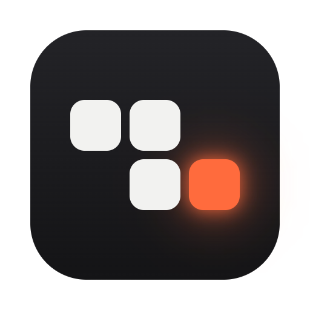
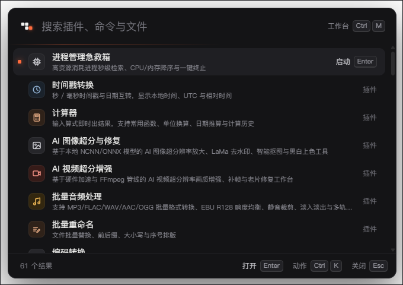

<p align="center">
  
</p>

<h1 align="center">ZTools</h1>

<p align="center">A desktop launcher and plugin toolbox for Windows and macOS</p>

<p align="center">
  <strong>English</strong> | <a href="README.zh-CN.md">简体中文</a>
</p>

<p align="center">
  <a href="https://www.ztools.cn">Website</a> ·
  <a href="https://github.com/ZToolsTeam/ZTools/releases">Releases</a> ·
  <a href="https://github.com/ZToolsTeam/ZTools-extensions">Extensions</a> ·
  <a href="https://github.com/ZToolsTeam/ZTools/issues">Issues</a>
</p>

ZTools brings application search, quick launch, and plugin utilities into a single desktop entry point:

- Two views: a full workspace dashboard and a floating launcher bar
- Keyboard-first navigation with light and dark themes
- Multilingual interface (English and Simplified Chinese)
- Declarative plugins rendered consistently by the desktop client

This repository contains the desktop client (Electron + Vue) and plugin SDKs. Plugin source code lives in [ZTools Extensions](https://github.com/ZToolsTeam/ZTools-extensions).

<p align="center">
  
  <br>
  <sub>Workspace dashboard: installed tools and featured plugins (macOS official build)</sub>
</p>

<p align="center">
  
  <br>
  <sub>Floating launcher bar: live search results (macOS official build, invoked with ⌥ Space)</sub>
</p>

## Open-Source Edition vs. Official Releases

This repository is the **open-source edition** of ZTools.

| Feature | Official Installers (Releases) | Built from Source |
| --- | --- | --- |
| Search, launcher, workspace, and plugin marketplace | Yes | Yes |
| Account sign-in, in-app feedback, plugin reviews & ratings | Yes | No |
| Cloud sync, usage telemetry, auto-update checks | Yes | No |

- Official installers are built from this same codebase plus closed-source account and cloud service modules.
- Building from source produces an offline client: it makes no calls to the official backend, while the public plugin marketplace continues to work as usual.
- See [Open-Source vs. Official Edition](docs/en/building.md#open-source-vs-official-edition) for details.

## Download

Pick a release from [GitHub Releases](https://github.com/ZToolsTeam/ZTools/releases) and download the installer under **Assets**:

| Platform | File |
| --- | --- |
| Windows x64 | `windows-x64.exe` installer, or `windows-x64-portable.zip` portable archive |
| macOS (Intel / Apple Silicon) | `darwin-universal.dmg` |

- Every asset ships with a matching `.sha256` checksum file.
- The **Source code** archives contain source files only and are not installers.

## Quick Start

Requires Node.js 24 and Git on Windows or macOS:

```bash
git clone https://github.com/ZToolsTeam/ZTools.git
cd ZTools
npm install
npm run dev
```

- `npm run dev` builds and launches the client without a file watcher. After making changes, exit the app and run it again.
- See [Building from Source](docs/en/building.md) for prerequisites, macOS packaging, and troubleshooting.

## Documentation

| Document | Description |
| --- | --- |
| [Building from Source](docs/en/building.md) | Prerequisites, development workflow, and macOS packaging |
| [Architecture Overview](docs/en/architecture.md) | Process model, IPC, plugin runtime, and security boundaries |
| [Testing](docs/en/testing.md) | Per-module test commands and test coverage requirements |
| [Coding Standards](docs/en/coding-standards.md) | Core principles, per-layer rules, line endings, and commit messages |
| [Contributing Guide](CONTRIBUTING.md) | Reporting issues, submitting pull requests, and contributor licensing |
| [Plugin Development](https://github.com/ZToolsTeam/ZTools-extensions) | Creating, testing, and submitting plugins |

## License

- **Desktop client**: Released under [GNU GPL v3.0](LICENSE) (`GPL-3.0-only`), including `packages/ai-mcp` and `packages/sync-crypto`.
- **Plugin SDK packages**: `packages/declarative-ui`, `packages/api`, and `packages/ztools-plugins-spec` are licensed under MIT (see the `license` field in each `package.json`).
- **Extensions repository**: See [ZTools Extensions LICENSE](https://github.com/ZToolsTeam/ZTools-extensions/blob/main/LICENSE).
- **Third-party dependencies**: Subject to their respective licenses.

When opening a Pull Request, you must check the contributor license confirmation agreeing to license your contribution under both `GPL-3.0-only` and `MIT`. See [Contributor Licensing](CONTRIBUTING.md#contributor-licensing) for why.
