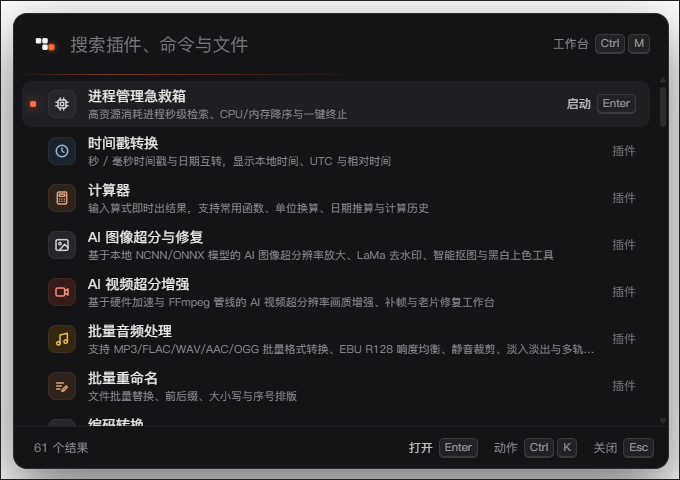

<p align="center">
  
</p>

<h1 align="center">ZTools</h1>

<p align="center">面向 Windows 与 macOS 的桌面启动器与插件工具箱</p>

<p align="center">
  <a href="https://www.ztools.cn">官网</a> ·
  <a href="https://github.com/ZToolsTeam/ZTools/releases">版本下载</a> ·
  <a href="https://github.com/ZToolsTeam/ZTools-extensions">插件源码</a> ·
  <a href="https://github.com/ZToolsTeam/ZTools/issues">问题反馈</a>
</p>

ZTools 将应用搜索、快捷启动和插件工具放在同一个桌面入口中，提供工作台与悬浮搜索条两种界面，支持键盘操作和明暗主题。

<p align="center">
  
  <br>
  <sub>工作台主界面：分类管理已安装工具、插件市场与最近使用记录</sub>
</p>

<p align="center">
  
  <br>
  <sub>极简悬浮搜索条（Alt + Space）：全键盘即时检索并启动插件、命令与本地文件</sub>
</p>

本仓库包含 Electron / TypeScript 客户端、Vue 界面层、声明式插件 SDK 及共享包。独立插件的源码、构建工具与投稿指南位于 [ZTools Extensions](https://github.com/ZToolsTeam/ZTools-extensions)。客户端与插件分别维护版本，使用时应核对各自的版本和运行条件。

## 下载与使用

在 [GitHub Releases](https://github.com/ZToolsTeam/ZTools/releases) 选择版本，并从该版本的 **Assets** 下载适合自己系统的文件：

| 平台 / 架构 | 文件类型 |
| --- | --- |
| Windows x64 | `.exe` 安装包或 `win32-x64-portable.zip` 便携包 |
| macOS Intel / Apple Silicon | `darwin-universal.dmg` 通用包 |

具体可用文件、系统要求及 SHA-256 校验文件以所选发布页为准。GitHub 自动生成的 **Source code** 压缩包用于获取源码；安装使用请选择上述客户端文件。`main` 分支的代码可能领先于已发布版本。

客户端面向 Windows 和 macOS。文件索引、窗口控制等系统能力，以及插件依赖的原生组件、外部工具和系统授权，可能随平台而异；请结合所用版本和插件清单确认可用范围。

## 从源码运行

建议使用 Node.js 24（含 npm，与仓库 macOS 构建流程一致）及 Git。安装过程需要下载 npm 依赖与 Electron。在 Windows 或 macOS 上执行：

```bash
git clone https://github.com/ZToolsTeam/ZTools.git
cd ZTools
npm install
npm run dev
```

后续命令均在仓库根目录执行：

- `npm install` 通过安装脚本检查并补齐 `electron-client/`、`frontend/` 缺失的依赖，同时准备声明式 UI 包的构建产物。
- `npm run dev` 通过启动入口准备构建产物并启动 Electron，不提供持续监听源码的热更新；修改后退出开发实例，再重新运行该命令。
- 根目录 `npm start` 与 `npm run dev` 使用同一个启动入口。

Windows 启动入口在 NativeHost32 尚未构建时会尝试编译它，需要 CMake 和 Visual Studio 2022 C++ 工具链；编译失败时启动脚本会跳过这一步，依赖该组件的功能仍需组件就绪后才能验证。平台相关原生源码见 [`electron-client/native/`](electron-client/native/)。

## 目录结构

| 目录 | 内容 |
| --- | --- |
| [`electron-client/`](electron-client/) | Electron 主进程、预加载桥接、系统服务与原生组件 |
| [`frontend/`](frontend/) | Vue 界面、搜索入口与声明式视图渲染器 |
| [`packages/declarative-ui/`](packages/declarative-ui/) | 声明式组件、运行时、宿主 API 与示例 |
| [`packages/api/`](packages/api/) | 插件 API 类型与契约 |
| [`packages/ztools-plugins-spec/`](packages/ztools-plugins-spec/) | 插件清单 Schema 与校验器 |
| [`packages/ai-mcp/`](packages/ai-mcp/) | 模型调用与 MCP 相关模块 |
| [`packages/sync-crypto/`](packages/sync-crypto/) | 加密与同步相关模块 |
| [`scripts/`](scripts/) | 依赖安装、开发启动及仓库工具 |
| [`tests/`](tests/) | 跨模块测试 |

## 构建与检查

安装依赖后，在仓库根目录执行：

```bash
# 构建客户端与界面，不启动窗口
npm --prefix electron-client run build

# 客户端类型、源码边界、单元测试与便携数据契约检查
npm run test:quick
```

构建产物位于 `electron-client/out/`，其中界面资源位于 `electron-client/out/assets/web/`。安装包打包、原生组件编译和签名使用各自的脚本，不包含在上述公共构建命令中。

`test:quick` 的检查范围由 [`run-test-workflow.mjs`](electron-client/scripts/run-test-workflow.mjs) 定义；平台相关测试还受本机系统和组件条件影响。修改快捷键、窗口、剪贴板或插件桥接时，需要在对应平台的真实 ZTools 客户端中验证交互。

## 参与贡献

- 客户端问题与建议：提交 [Issue](https://github.com/ZToolsTeam/ZTools/issues)，附上系统及架构、客户端版本（源码运行时附提交号）、复现步骤、预期与实际结果。
- 客户端代码修改：提交 Pull Request，说明改动范围、测试命令及验证的平台。日志和截图请先去除个人信息与凭据。
- 插件开发与投稿：参阅 [ZTools Extensions 贡献指南](https://github.com/ZToolsTeam/ZTools-extensions/blob/main/CONTRIBUTING.md)。

## 许可证

仓库根目录提供 [GNU GPL v3.0](LICENSE) 许可证文本。独立包及第三方依赖另有许可声明时，请一并查看对应文件；插件仓库的许可证见 [ZTools Extensions LICENSE](https://github.com/ZToolsTeam/ZTools-extensions/blob/main/LICENSE)。
