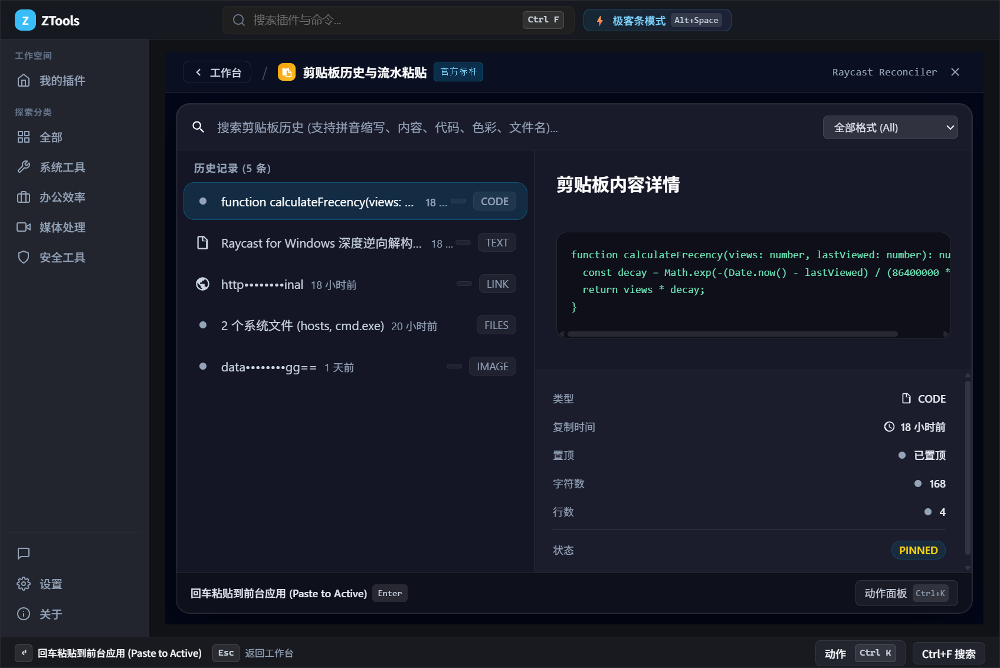
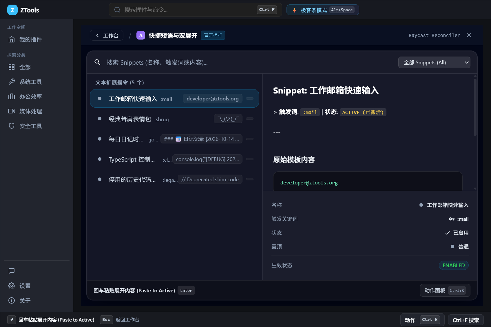
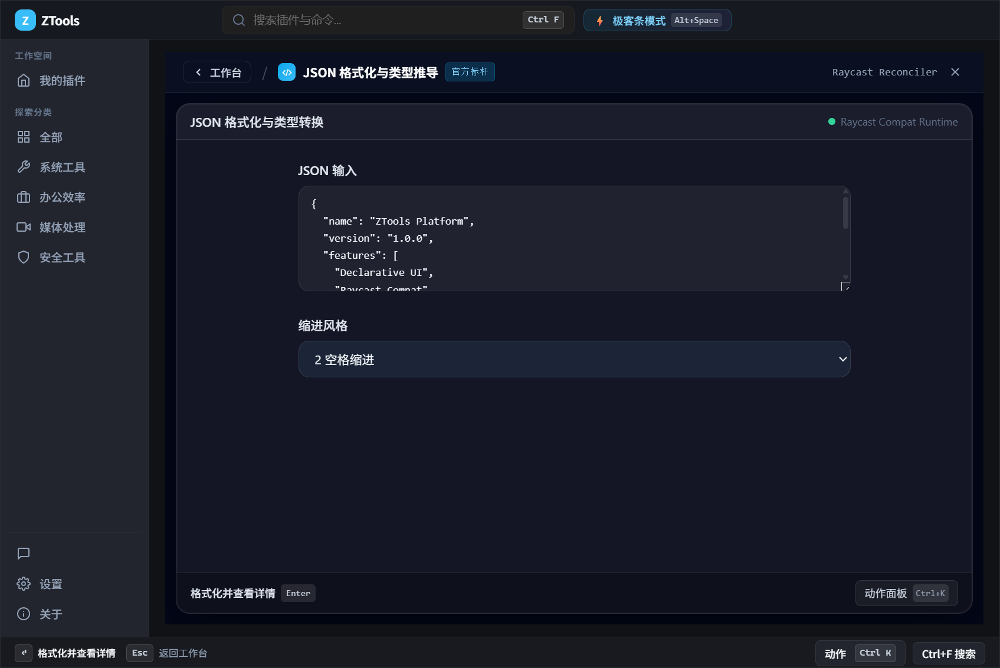
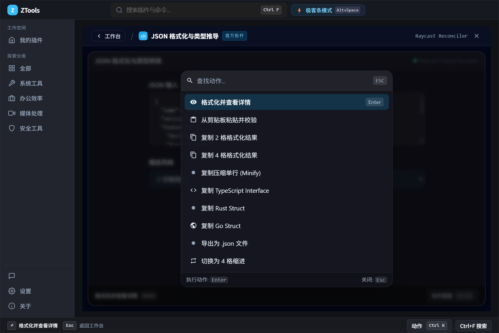

# ZTools

<p align="center">
  <strong>现代化、高性能、纯粹开源的 Windows & macOS 双端效率启动器与插件中枢</strong>
</p>

<p align="center">
  <a href="#license"></a>
  <a href="https://github.com/codingmuse/ZTools/actions"></a>
  <a href="https://nodejs.org"></a>
  <a href="https://www.electronjs.org"></a>
  <a href="CHANGELOG.md"></a>
</p>

---

## 💡 为什么选择 ZTools？

ZTools 彻底卸下历史兼容包袱，采用现代极客工程实践，致力于打造对标国际一流的下一代桌面效率平台：

- 🚀 **毫秒级极速启动与出窗**：唤醒延迟严格压制在 100ms 以内（SLA < 100ms），待机时主动释放 GPU 资源，常驻托盘内存轻量稳定。
- ⚡ **硬件级 NTFS MFT / USN 秒级索引**：内置 Rust 编写的高性能侧车引擎，实测 100 万文件检索平均延迟仅 **0.035ms**，告别传统扫描卡顿。
- 🎨 **纯粹声明式 UI 体系**：彻底封杀原生 DOM/CSS 随意自由发挥，扩展统一采用语义化组件（`<List>`, `<Detail>`, `<Form>`, `<ActionPanel>`），由宿主统一呈现沉浸式 Fluent / Mica 亚克力亚态毛玻璃质感与自适应主题。
- ⌨️ **全键盘优先极客流**：上下键自动滚屏聚焦、`Enter` 激活首要动作、`Ctrl+K` 呼出动作面板、`Esc` 返回上级导航栈，双手不离键盘。
- 🔒 **Local-First 与极致隐私优先**：数据 100% 留存在本地 SQLite，绝不强弹登录窗口，支持 Argon2id + AES-256-GCM 端到端加密（E2EE）通过 WebDAV 或 GitHub Gist 自主同步。
- 🤖 **AI Native 与原生 MCP 网关**：支持 BYOK（自带 DeepSeek、OpenAI、Claude Key），原生支持 DeepSeek R1 思考流与本地离线模型自动嗅探（Ollama / LM Studio 直连）。

---

## 📸 界面预览与实机展示 (Screenshots)

### 1. 双模态一体化：大主界面工作台 (Dashboard) 与 极客悬浮搜索条 (Launcher)
> 支持 `Ctrl/Cmd + M` 一键在“全能大主界面”与“极客悬浮搜索条”之间丝滑切换，共用统一搜索内核与声明式渲染舞台。

<p align="center">
  
</p>
<p align="center">
  <em>▲ 全能大主界面工作台（Dashboard）：内置 38 款第一方核心生产力套件与市场热门扩展，支持方向键网格聚焦高亮与一键启动</em>
</p>

<p align="center">
  
</p>
<p align="center">
  <em>▲ 极客悬浮搜索条（Launcher）：毫秒级呼出，支持中文拼音首字母匹配、Frecency 频度衰减排序与纯键盘流操作</em>
</p>

### 2. 第一方核心内置套件：剪贴板历史 & 快捷短语宏展开 (Snippets)
> 开箱即用、零网络依赖，数据 100% 本地 SQLite WAL 持久化，支持主列表 `<List>` + 右侧代码/Markdown 预览 + Metadata 属性面板。

| 剪贴板历史与流水粘贴 (`clipboard-history`) | 快捷短语与动态宏展开 (`snippets`) |
|---|---|
|  |  |
| *支持文本/代码/图片/文件/颜色分类过滤、敏感密码脱敏与顺序流水粘贴* | *全局触发词实时监听退格展开，支持 `{clipboard}` / `{date}` / `{cursor}` 宏* |

### 3. 纯粹声明式 UI 舞台 (`<Form>` / `<Detail>`) 与 `Ctrl+K` 极客动作面板 (`ActionPanel`)
> 彻底封杀原生 DOM/CSS 自由注入，由 `@ztools/declarative-ui` 统一转译虚拟视图描述符，按下 `Ctrl/Cmd + K` 即刻唤起上下文动作面板。

| 声明式表单与实时类型推导 (`DeclarativeView`) | `Ctrl+K` 极客动作面板 (`ActionPanel`) |
|---|---|
|  |  |
| *JSON 实时校验、格式化与 TypeScript / Rust / Go 类型推导* | *四级快捷键分发器，一键触发首要/次要动作或模糊检索全部操作* |

### 4. 现代化偏好设置与快捷键中心
<p align="center">
  
</p>
<p align="center">
  <em>▲ 偏好设置中心：支持明暗主题切换、全局唤醒快捷键、默认呼出形态（应用工作台 / 极客悬浮条）与独立插件热键映射</em>
</p>

---

## 🏗️ 架构与生态（双仓飞轮）

ZTools 采用**“核心宿主大仓 + 插件生态大仓”**的双仓解耦模式：

1. **核心宿主大仓（当前仓库）**：
   - `electron-client/`：基于 Electron 43 + TypeScript 打造的轻量现代化宿主；
   - `frontend/`：Vue 3 纯声明式渲染器；
   - `packages/`：公共核心基础设施（`@ztools/declarative-ui` SDK、`@ztools/ai-mcp` 网关、`@ztools/sync-crypto` 加密核心等）；
   - 随包内置预编译的 Rust Native 侧车（`ztools-indexer.exe` 与 `ztools-uiaccess.exe`），普通开发者无需配置 C++ 或 Rust 编译环境。
2. **插件生态大仓（[ZTools-extensions](https://github.com/codingmuse/ZTools-extensions)）**：
   - 包含日常开源通用插件与社区提交插件；
   - 内置一键脚手架（`npm run create-plugin`）；
   - 开放治理模式：**开放投稿，投稿即 PR，经 CI AST 安全扫描后官方审核合并，免运维静态分发**。

---

## 📦 安装包下载与双平台构建 (Windows & macOS Releases)

每次正式版本发布均在 [GitHub Releases](https://github.com/codingmuse/ZTools/releases) 同步提供 **Windows** 与 **macOS** 双平台安装包（附带 `.sha256` 完整性校验）：

| 平台 | 产物格式 | 文件名示例 | 适用场景 |
| :--- | :--- | :--- | :--- |
| **Windows 10 / 11 (x64)** | **EXE 离线安装包** | `ZTools-<version>-win32-x64.exe` | 推荐普通用户，内置 Direct2D 极速安装向导与平滑升级 |
| **Windows 10 / 11 (x64)** | **ZIP 免安装便携包** | `ZTools-<version>-win32-x64-portable.zip` | 推荐极客用户，解压即用，配置与数据本地自包含 |
| **macOS 13.0+ (Universal)** | **DMG 通用磁盘镜像** | `ZTools-<version>-darwin-universal.dmg` | 原生同时支持 **Apple Silicon (M1–M4)** 与 **Intel** 芯片 |

---

## ⚡ 快速开始（30 秒跑起本地环境）

环境要求：
- [Node.js](https://nodejs.org/) >= 20.0.0 (推荐 22+)
- Windows 10/11 或 macOS 13+

### 1. 克隆代码

```bash
git clone https://github.com/codingmuse/ZTools.git
cd ZTools
```

### 2. 安装依赖并启动（Windows / macOS 通用）

```bash
# 自动安装全工作区依赖并构建声明式 UI 核心包
npm install

# 一键启动开发环境（自动适配 Windows 与 macOS）
npm run dev
```

### 3. 运行测试与双端发包命令

```bash
# 运行 TypeScript 边界与单元契约测试
npm run test:quick

# 运行全链路混沌抗毁性集成测试
npm test

# 一键打包并同时发布 Windows (EXE + ZIP) 与云端编译 macOS Universal DMG 至 GitHub Releases
npm run release:binaries

# 单独触发 GitHub Actions 云端 Mac 真机编译 DMG（加 :download 可自动拉回本地 dist/macos/）
npm run release:mac
```

---

## 🛠️ 参与贡献与插件开发

想要为 ZTools 开发插件？无需克隆本仓库！

1. 访问插件大仓：[ZTools-extensions](https://github.com/codingmuse/ZTools-extensions)；
2. 运行 `npm run create-plugin my-tool` 一键生成遵循声明式规范的标准工程；
3. 打开电脑上正在运行的 ZTools 客户端，在「设置」->「开发者」中直接加载本地目录实时预览；
4. 编写完成直接提交 PR，官方审核后全网用户即可一键安装！

---

## 🗺️ 开发路线图 (Roadmap)

ZTools 采用现代声明式交互与开源插件生态范式，规避多语言臃肿缝合包袱，按阶段高速推进跨平台全覆盖（依托 AI 驱动研发，不设固定排期限制，以工程验收门禁为准绳持续迭代）：

- **Stage 1（核心底座与双模态统一）**：纯 TS 宿主 + 预编译 Rust 侧车（NTFS MFT 百万文件秒搜 & UIAccess 穿透）、悬浮窗与大主界面双模态（`Ctrl/Cmd+M`）、四级快捷键分发器、38 款第一方核心内置套件基座与 BYOK/本地离线 AI 路由；
- **Stage 2（扩展宿主与生态大仓闭环）**：`utilityProcess` + `worker_threads` 隔离扩展宿主（100MB 堆上限与预热池）、支持 `@ztools.*` 元数据注释的 `Script Commands` 脚本引擎、扩展 `tool` 自动接入 MCP、市场一键静默安装与 AST 安全扫描上架闭环；
- **Stage 3（macOS 原生体验全量交付）**：Universal (`arm64` + `x86_64`) 双架构构建与 Apple 自动公证、`AXUIElement` 跨进程取词与菜单栏导航、Spotlight 秒搜与 `Quick Look` 预览、`ScreenCaptureKit` 高分屏截屏与 TCC 权限自愈引导；
- **Stage 4（Linux 极客桌面与团队协同）**：Wayland (`XDG GlobalShortcuts Portal` / `wlr-layer-shell`) 与 X11 双栈适配、KWin/Mutter/Hyprland/Sway 多后端窗口分屏、`AT-SPI2` 取词与 Fcitx5 中文输入法兼容、AppImage/Flatpak/AUR 全渠道分发及 ZTools for Teams 协同。

👉 查看完整的架构图、38 款内置套件清单与三大平台技术细节：**[ROADMAP.md](ROADMAP.md)**

---

## 📋 更新日志 (Changelog)

ZTools 自 **2025 年 11 月**立项发布 `v0.1.0` 以来持续高频迭代，遵循 [Keep a Changelog](https://keepachangelog.com/zh-CN/1.1.0/) 规范记录每一次演进：

- **v1.1.8.1（2026-10-19）**：完成全量 35 款声明式 2.0 自营插件三大标准布局范式升级与极简单色视觉清洗；全面解封 macOS 与 Windows 双端 35 款核心插件可用性，修复本地旧版插件别名去重合并，并全量更新发布至线上 CDN 与双端三包（`.exe` + `-portable.zip` + `-darwin-universal.dmg`）。
- **v1.1.8.0（2026-10-17）**：发布 Windows（`.exe` + `-portable.zip`）与 macOS Universal（`-darwin-universal.dmg`）双平台三包齐发版；实现 `npm install && npm run dev` 跨平台零门槛启动、内置生产力插件与 26 款社区扩展全量呈现，落地内联计算器/换算/色板 (`E4`)、窗口分屏 `Restore` (`E5`)、3500+ 汉字拼音多音字高亮 (`E6`)、`Snippets` 动态参数表单 (`E7`) 与 `Script Commands` 四模式 ANSI 渲染 (`E8`)。
- **v1.1.7.1（2026-10-16）**：升级声明式 UI 2.0 (`@ztools/declarative-ui`)、客户端「积木 Z × 余烬橙」品牌视觉重设计（亮/暗双主题）、新增微软官方 Winget 自动化分发流水线 (`npm run release:winget`)、修复内置 Web 资源按内容指纹刷新。
- **v1.0.0（2026-10-14）**：结束 `0.x` 早期架构演进，正式发布双仓开源 `1.0` 现代架构，集成预编译 Rust 侧车（NTFS MFT 毫秒级索引 & UIAccess 穿透）、Local-First SQLite WAL 底座、去中心化 E2EE 云同步与 BYOK / 本地离线 AI 网关。
- **v0.1.0 ~ v0.8.0（2025-11-20 ~ 2026-04-29 早期版本演进）**：完成初代客户端与插件 SDK 诞生 (`v0.1.0`)、全局暗黑模式与插件分类体系 (`v0.3.0`)、超级面板与插件增量热更新 (`v0.5.0`)、全局插件快捷键中心与窗口控制 SDK (`v0.8.0`)。

👉 查看全部历史版本与详细变更记录：**[CHANGELOG.md](CHANGELOG.md)**

---

## 📄 开源协议 (License)

- 本仓库核心宿主代码基于 [GNU General Public License v3.0 (GPL-3.0)](LICENSE) 协议开源，严格禁止任何第三方闭源套壳分发。
- 插件生态（`@ztools/declarative-ui` 及官方通用扩展）基于宽松的 [MIT License](https://opensource.org/licenses/MIT) 授权，保障社区开发者最大自由度。
