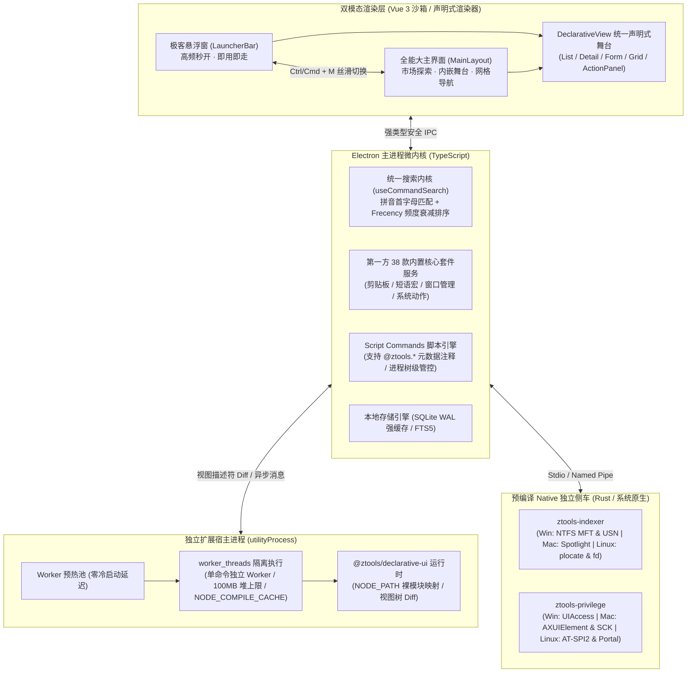
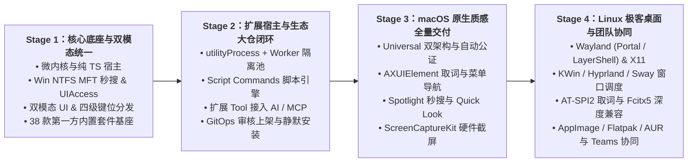

# 🗺️ ZTools 官方开发路线图 (Product & Engineering Roadmap)

> **项目愿景**：采用现代桌面极客产品哲学与工程实践，彻底规避传统多语言臃肿缝合与闭源黑盒包袱。致力于打造**“纯粹开源、免费极客、轻量宿主、极致性能”**，完整覆盖 **Windows、macOS、Linux** 三大桌面操作系统的下一代效率启动器与智能中枢。

  
  
  
  

---

## 📑 目录
1. [为什么选择 ZTools：告别传统启动器痛点，重塑现代桌面效率](#-为什么选择-ztools告别传统启动器痛点重塑现代桌面效率)
2. [现代化核心架构与双模态交互体系](#-现代化核心架构与双模态交互体系)
3. [第一方 38 款核心内置应用全景矩阵](#-第一方-38-款核心内置应用全景矩阵)
4. [跨平台三大系统硬核落地规划 (Windows / macOS / Linux)](#-跨平台三大系统硬核落地规划-windows--macos--linux)
   - [Windows 篇：特权穿透与硬件级底层深化](#1-windows-平台特权穿透与硬件级底层深化)
   - [macOS 篇：媲美原生质感与系统级能力适配](#2-macos-平台媲美原生质感与系统级能力适配)
   - [Linux 篇：填补桌面极客空白的全协议攻坚](#3-linux-平台填补桌面极客空白的全协议攻坚)
5. [扩展运行时、声明式 UI 与开发者生态 (DX First)](#-扩展运行时声明式-ui-与开发者生态-dx-first)
6. [AI Native、屏幕感知与 MCP 智能中枢](#-ai-native屏幕感知与-mcp-智能中枢)
7. [演进阶段里程碑 (Evolution Stages)](#-演进阶段里程碑-evolution-stages)
8. [如何参与共建 (Contributing)](#-如何参与共建-contributing)

---

## 🎯 为什么选择 ZTools：告别传统启动器痛点，重塑现代桌面效率

传统桌面启动器在跨平台工程化、扩展一致性与开源开放性上普遍存在明显妥协。ZTools 坚持**“原生声明式交互范式 + 工程上重塑轻量跨平台解耦架构”**：

| 维度 | 核心设计准则 | 传统工具常见的短板与包袱 (坚决规避) | ZTools 现代化极客方案 (差异化超越) |
|---|---|---|---|
| **界面与视觉** | **严格声明式 UI**：封杀原生 DOM/CSS 自由发挥，扩展只产出语义化描述符，宿主统一呈现毛玻璃质感与主题。 | 任意注入 DOM/CSS 容易导致样式混乱與卡顿。 | 统一声明式规范（`<List>`, `<Detail>`, `<Form>`, `<ActionPanel>`），杜绝样式污染、闪烁与内存泄漏。 |
| **模态与空间** | 经典悬浮搜索框（Launcher），高频用完即走。 | **无大主界面（Dashboard）**：在逛市场、看长文档、复杂配置与系统诊断时空间局促，新手面对空搜索框门槛高。 | **首创双模态一体化（Launcher + Dashboard）**：`Ctrl/Cmd+M` 一键无缝切换悬浮窗与大主界面，共用搜索内核与声明式舞台。 |
| **交互哲学** | **纯粹键盘流**：`Enter` 首选、`Ctrl/Cmd+K` 动作面板、方向键聚焦、`Esc` 逐级回退，双手不离键盘。 | 弹窗嵌套繁琐，键鼠频繁切换。 | 统一四级优先级快捷键分发器（`动作面板 > 声明式舞台 > 页面 > 全局`），支持卡片网格全键盘导航与拼音首字母秒搜。 |
| **宿主架构** | 独立扩展进程 + Worker 线程隔离 + 特权能力下沉。 | **臃肿多语言缝合**：安装包高达数百 MB，待机常驻内存偏高，本地编译门槛极高。 | **纯 TypeScript 宿主 (Electron 43) + 独立预编译 Rust 侧车**：安装包 **~100MB**，待机内存 **<200MB**，唤醒延迟 **SLA <100ms**。 |
| **开源与信任** | 社区扩展仓库开源，官方审核 + GitOps 分发。 | 客户端核心为**闭源黑盒商业软件**；AI 订阅存在强绑定倾向。 | **核心宿主 GPL-3.0 开源 + 插件生态 MIT 开源**；支持 **BYOK（自带大模型 Key）+ 本地离线模型直连** + 端到端加密（E2EE）自建同步。 |
| **操作系统支持** | 统一平台适配层，全平台一致开发体验。 | **单平台局限或缺乏 Linux 支持**。 | **三大桌面平台全覆盖**：Windows 硬件级穿透 + macOS 原生体验 + **填补 Linux 现代效率启动器空白**。 |

---

## 🏗️ 现代化核心架构与双模态交互体系

ZTools 采用**“双模态渲染壳层 + 轻量微内核主进程 + `utilityProcess` 扩展宿主 + 预编译 Rust 原生侧车”**的四层解耦架构：

### 双模态与全键盘交互核心设计
1. **双模态无感协同**：悬浮窗（Launcher）与大主界面（Dashboard）共用同一个 `useCommandSearch` 搜索内核（全程零网络请求阻塞）、同一套 `SEARCH / GRID / DECLARATIVE` 三态焦点状态机与同一个内嵌声明式舞台。
2. **四级快捷键分发器**：严格按照 `动作面板 (ActionPanel) > 声明式舞台 (Declarative) > 页面级 (Page) > 全局 (Global)` 优先级单次消费按键，彻底根除快捷键冲突：
   - `Enter`：执行首要动作（Primary Action）；
   - `Ctrl/Cmd + Enter`：执行次要动作（Secondary Action）；
   - `Ctrl/Cmd + K`：**唯一职责**打开/关闭当前项或插件的动作面板（ActionPanel）；
   - `Ctrl/Cmd + F` 或 `/`：在大主界面快速聚焦顶部命令面板搜索框；
   - `Esc`：逐级后退（关闭动作面板 → 退出内嵌舞台子栈 → 回到卡片网格 → 清空搜索或隐藏悬浮窗）。

---

## 🧩 第一方 38 款核心内置应用全景矩阵

一个顶级启动器的灵魂在于**“开箱即用、零外部依赖、毫秒级响应”的第一方内置套件**。ZTools 严格区分“内置核心基础设施”与“商店按需安装的社区扩展”，规划并持续完善 **6 大领域、38 款第一方核心内置套件（160+ 核心命令）**：

### 一、 核心生产力基石（8 大套件）
| # | 套件标识 | 名称 | 核心命令与能力亮点 |
|---|---|---|---|
| 1 | `clipboard-history` | **剪贴板历史与流水粘贴** | SQLite WAL 持久化、文本/图片/文件/颜色分类检索、高熵密码与敏感内容自动脱敏、**顺序流水粘贴（Paste Sequentially）** |
| 2 | `snippets` | **快捷短语与动态宏展开** | 全局触发词实时监听与自动退格替换，支持 `{clipboard}`、`{date}`、`{time}`、`{cursor}`（光标定点回移）动态占位符与 JSON 导入导出 |
| 3 | `file-search` | **硬件级极速文件秒搜** | 对接底层索引侧车（MFT / Spotlight / plocate），多盘符通配过滤、流式 SHA-256 校验、原生空格快速预览（Quick Look） |
| 4 | `calculator` | **智能计算器与色彩速查** | 搜索框实时安全计算复杂数学表达式、单位与进制换算、HEX/RGB/HSL 色彩模型实时色块预览与一键转换 |
| 5 | `window-management` | **窗口极速调度与分屏** | 覆盖左/右半屏、上/下半屏、四分之一屏、最大化、居中、合理尺寸、跨显示器迁移等 **15+ 种无延迟分屏动作**与 HUD 提示 |
| 6 | `system` | **系统极客运维面板** | 锁屏、睡眠、重启、关机、清空回收站、隐藏其他应用、安全弹出所有磁盘、音量/静音切换、强杀无响应进程（带高危二次确认） |
| 7 | `quicklinks` | **快捷直达链接引擎** | 支持自定义带参模板（如 `gh: https://github.com/{query}`），参数自动 URL 编码与非法协议安全拦截 |
| 8 | `script-commands` | **本地极客脚本命令** | 自动扫描本地脚本目录，**100% 支持 `@ztools.*` 头部元数据注释规范**，直接将 `.ps1` / `.sh` / `.py` / `.js` 转化为可视化交互命令 |

### 二、 日常高频实用工具（8 大套件）
| # | 套件标识 | 名称 | 核心命令与能力亮点 |
|---|---|---|---|
| 9 | `emoji-picker` | **Emoji 与特殊符号库** | 内置 Unicode 15.0+ 符号库，支持**中文语义与拼音首字母检索**（如输 `dz` 找 👍）、肤色变体、最近使用与收藏 |
| 10 | `translator` | **极速划词与多语互译** | 结合特权穿透抓取前台选中文本，一键调起多语言对照翻译、词义解析与替换回填 |
| 11 | `notes` | **轻量极客便签系统** | 本地 SQLite FTS5 全文毫秒级检索、Markdown 实时渲染、悬浮置顶记录与导出 |
| 12 | `system-run` | **系统命令与别名直达** | 扫描系统 `PATH` 与注册表/应用目录，支持带参直接派生系统命令与自定义启动别名 |
| 13 | `taskbar-dock` | **任务栏 / Dock 极速控制** | 一键切换系统任务栏或 macOS Dock 的自动隐藏与显隐状态 |
| 14 | `screenshots` | **截图历史管理与回贴** | 实时监听系统截图目录，支持历史截图时间线检索、OCR 识别与 `pasteLatestScreenshot` 一键回贴最新截图 |
| 15 | `applications` | **应用卸载与后台治理** | 快速检索已安装程序并调起卸载，支持配置“应用闲置/休眠时自动退出（Auto Quits）”白名单 |
| 16 | `dictionary` | **本地离线词典速查** | 毫秒级查询中英文单词释义、音标、词根词缀与同义词 |

### 三、 极客与开发者套件（6 大套件）
| # | 套件标识 | 名称 | 核心命令与能力亮点 |
|---|---|---|---|
| 17 | `developer` | **扩展开发者工作台** | 一键生成标准插件工程、挂载本地未打包源码目录、HMR 热重载调试、Worker 内存与日志实时诊断 |
| 18 | `mcp` | **MCP 协议网关管理** | 可视化安装、启停与监控 Model Context Protocol Servers（支持 Stdio / SSE / InMemory） |
| 19 | `focus` | **专注时钟与番茄工作法** | 自定义专注分类与目标时长、托盘倒计时显示、专注期间干扰应用拦截提醒 |
| 20 | `typing-practice` | **极客代码打字训练场** | 内置多语言经典代码片段与英文短文，实时统计 WPM 键速、准确率与键位热力 |
| 21 | `games` | **极客休息室小游戏** | 纯声明式/轻量 Canvas 内置解压小游戏（如 2048、贪吃蛇、扫雷），零网络即开即玩 |
| 22 | `diagnostics` | **宿主性能与内存诊断** | 实时追踪主进程、渲染进程、扩展宿主与各 Worker 的内存水位走势，内置压力测试数据生成器 |

### 四、 网络、搜索与浏览器联动（4 大套件）
| # | 套件标识 | 名称 | 核心命令与能力亮点 |
|---|---|---|---|
| 23 | `web-searches` | **全网搜索引擎多源直达** | 内置 Google、Bing、DuckDuckGo、百度、GitHub、知乎、B站等搜索模板，支持选中文本直接搜索 |
| 24 | `urls` | **URL 智能识别与直达** | 剪贴板或输入框 URL 格式自动嗅探，一键调用指定浏览器打开 |
| 25 | `browser` | **浏览器深度联动助手** | 检索 Chrome / Edge / Arc / Safari / Firefox 打开的标签页（Tabs）、书签与历史记录，一键跳转聚焦 |
| 26 | `contacts` | **本地通讯录秒搜** | 检索本地联系人姓名（含拼音）、电话、邮箱，支持一键复制或发起邮件 |

### 五、 AI Native 与多模态感知（4 大套件）
| # | 套件标识 | 名称 | 核心命令与能力亮点 |
|---|---|---|---|
| 27 | `ai-chat` | **原生 AI 智能对话中枢** | 统一 `ModelRouter`（BYOK 直连 DeepSeek R1 思考流 / OpenAI / Claude + 本地 Ollama/LM Studio 离线直连），支持预设 AI Commands |
| 28 | `screen-awareness` | **屏幕视觉感知交互** | 支持将**当前选中文本、活动窗口截图、框选屏幕区域或全屏画面**一键发送给多模态 AI 进行代码解读、排错或翻译 |
| 29 | `dictation` | **极速语音听写输入** | 对接系统原生语音识别与本地离线 Whisper 模型，按住快捷键说话即可转文字直接输入到当前光标处或发给 AI |
| 30 | `calendar` | **日历与日程议程管理** | 解析本地 iCalendar (ICS) 与 CalDAV/WebDAV 日程，一键查看今日议程、快速加入视频会议链接 |

### 六、 宿主治理、自动化与团队协同（8 大套件）
| # | 套件标识 | 名称 | 核心命令与能力亮点 |
|---|---|---|---|
| 31 | `settings` | **系统偏好设置中心** | 涵盖通用外观、窗口模式、全局热键、**HyperKey 映射**、云同步（E2EE）、AI 模型配置与扩展权限管理 |
| 32 | `navigation` | **活动窗口与菜单栏搜索** | 实时跨窗口快速切换（Switch Windows），检索并直接触发当前前台应用的顶部菜单栏命令（Search Menu Items） |
| 33 | `shortcuts-automation`| **系统快捷自动化桥接** | Windows 端对接任务计划与批处理工作流；macOS 端原生对接系统「快捷指令（Shortcuts.app）」；Linux 端对接 Systemd / Shell |
| 34 | `wrapped` | **个人效率数据年度回顾** | 基于本地 SQLite 纯离线聚合统计唤醒次数、高频插件、节省时间与按键里程碑，生成极客可视化数据卡片 |
| 35 | `core-updater` | **版本更新与变更日志** | 增量更新检测、原子化升级回滚保护、内置版本更新日志（What's New）渲染 |
| 36 | `account` | **账户与端到端密钥管理** | 本地主密码（Master Password）管理、Argon2id 密钥派生状态与同步设备会话管理 |
| 37 | `organizations` | **团队与组织协同中心** | 团队私有扩展源配置、团队共享 Snippets 快捷短语与共享 Quicklinks 同步 |
| 38 | `onboarding` | **极客新手指引与生态向导** | 交互式键盘快捷键训练营、核心功能导览与一键从旧启动器工具导入配置 |

---

## 💻 跨平台三大系统硬核落地规划 (Windows / macOS / Linux)

ZTools 通过统一的 `PlatformAdapter` 接口将平台差异全部下沉至底层，上层业务逻辑与 `window.ztools` / `@ztools/declarative-ui` SDK 保持 **100% 跨平台签名一致**。

### 1. Windows 平台：特权穿透与硬件级底层深化

| 核心领域 | 工程技术方案与细节 | 状态 |
|---|---|---|
| **NTFS MFT 裸盘秒搜与 USN 增量** | • 独立预编译 Rust 侧车 `ztools-indexer.exe`，直接解析 NTFS 主文件表（MFT），百万文件检索平均耗时 **0.035ms**（SLA < 10ms） • 持续完善 USN Journal 毫秒级增量变更监听，文件新建/重命名/删除实时同步索引，零后台 CPU 轮询开销 • 非 NTFS 卷（ReFS / exFAT / 网络映射盘）自动平滑降级为多线程目录遍历 | 🟢 已上线 / 持续深化 |
| **UIAccess 跨权限穿透** | • 独立预编译 `ztools-uiaccess.exe` 侧车，通过 UIAccess 数字签名与系统安全目录令牌穿透 Windows UIPI 隔离 • 支持在管理员高权限窗口（Admin Terminal / TaskMgr / IDE）中无障碍抓取选中文本、注入短语展开与捕获全局热键 • 通过 UI Automation 实时读取 Chrome / Edge / Brave / Arc 前台活跃 Tab 的标题与 URL | 🟢 已就绪 |
| **Win32 窗口管理与视觉合成** | • 基于 `SetWindowPos`、`DwmGetWindowAttribute`（精准计算隐形阴影边框补偿）实现 15+ 种像素级对齐的窗口分屏吸附 • 适配 Windows 11 原生 Mica（云母）/ Acrylic（亚克力）材质与圆角阴影，窗口隐藏 15 秒后主动释放 GPU 显存 | 🟢 已就绪 |

---

### 2. macOS 平台：媲美原生质感与系统级能力适配

| 核心领域 | 工程技术方案与细节 | 状态 |
|---|---|---|
| **Universal 双架构与苹果公证** | • 原生构建 Apple Silicon (`arm64`) 与 Intel (`x86_64`) 双架构 Universal 软件包 • 配置 `entitlements.mac.plist` 开启 Hardened Runtime，集成 Apple Developer ID 签名与 `xcrun notarytool` 自动公证，首次安装零 Gatekeeper 拦截 • 提供标准 DMG 安装器与 Homebrew Cask (`brew install --cask ztools`) 官方源 | 🟢 构建已通 / 门禁闭环中 |
| **macOS HIG 原生交互与视觉** | • 遵循 macOS Human Interface Guidelines：构建标准顶部 `NSMenu`（支持 `Cmd+,` 偏好设置、Services 联动） • Dock 生命周期管理：关闭窗口不退出进程，点击 Dock 图标触发 `activate` 秒级重开；支持“纯 MenuBar 驻留模式”（隐藏 Dock 图标） • 集成 macOS `NSVisualEffectView` 原生 Vibrancy 毛玻璃与红绿灯交通灯控件自适应 | 🟢 已就绪 |
| **Accessibility 穿透与菜单栏导航** | • 基于 macOS `AXUIElement` (Accessibility API) 抓取任意前台应用选中文本、活动窗口几何信息，以及遍历当前应用顶部 Menu Bar 菜单项（支撑 `navigation` 套件） • 结合 AppleScript / JXA 无感读取 Safari / Chrome / Arc 当前活跃标签页 URL • 支持 macOS 极客常用的 **HyperKey (`Caps Lock` → `Cmd+Ctrl+Opt+Shift`)** 键位映射与智能 `CommandOrControl` 转换 | 🟡 重点攻坚 |
| **Spotlight 秒搜与 Quick Look** | • 原生桥接 macOS Metadata Framework (`mdfind` / `NSMetadataQuery`) 与 APFS `FSEvents` 文件系统变更流，零额外磁盘负担实现秒级检索 • 在文件列表中按空格键直接唤起 macOS 原生 `QLPreviewPanel` (Quick Look) 预览文档、图片、音视频与代码 | 🟡 重点攻坚 |
| **ScreenCaptureKit 与 TCC 权限治理** | • 采用 macOS 12.3+ `ScreenCaptureKit` (SCK) 硬件加速管线实现跨显示器、Retina 高分屏（Backing Scale Factor 精准映射）截屏、取色与窗口画面捕获（支撑 `screen-awareness`） • 统一 TCC 隐私权限状态机（辅助功能、屏幕录制、完全磁盘访问）：未授权时展示沉浸式引导面板一键跳转「系统设置」，监听 `runtime_permission_changed` 授权后无感自动恢复 | 🟡 重点攻坚 |

---

### 3. Linux 平台：填补桌面极客空白的全协议攻坚

> **战略意义**：Linux 现有的开源启动器（Rofi / Wofi / Albert / Ulauncher）普遍存在“配置晦涩、UI 简陋、缺乏现代声明式扩展生态、Wayland 兼容性差”的痛点。ZTools 将打造 **Linux 桌面首个具备完整声明式扩展生态与原生性能的现代效率中枢**。

| 核心领域 | 工程技术方案与细节 | 状态 |
|---|---|---|
| **Wayland & X11 双显示协议栈** | • **Wayland 全局热键突破**：对接 XDG Desktop Portal (`org.freedesktop.portal.GlobalShortcuts`) D-Bus 接口，解决 Wayland 安全模型下无法全局监听快捷键的核心难题 • **Wayland 图层合成器集成**：针对 wlroots 系合成器（Sway / Hyprland / River），支持 `wlr-layer-shell` 协议将悬浮窗作为顶层 Overlay 渲染，不被普通窗口遮挡或平铺挤占 • **X11 完备兼容**：基于 XCB / X11 (`XGrabKey`, `_NET_ACTIVE_WINDOW`, EWMH) 实现毫秒级热键响应与焦点控制 | 🔵 架构已定 / 推进中 |
| **主流桌面环境 (DE) 与平铺 WM 窗口调度** | • 由于 Linux/Wayland 缺乏统一的跨合成器窗口移动 API，`window-management` 套件采用**多后端自适应驱动**：   - **KDE Plasma (KWin)**：通过 KWin D-Bus Scripting 接口调度窗口分屏；   - **GNOME (Mutter)**：提供轻量 Shell D-Bus 桥接扩展或 XDG Window 动作；   - **Hyprland / Sway / i3wm**：直接通过 UNIX Domain Socket (`hyprctl` / `swaymsg` / `i3-msg` IPC) 实现零延迟窗口平铺与工作区迁移；   - **X11 通用环境**：通过 `_NET_MOVERESIZE_WINDOW` 标准协议直接控制 | 🔵 规划中 |
| **AT-SPI2 无障碍取词、双剪贴板与输入法兼容** | • **跨进程取词与菜单检索**：基于 Linux `AT-SPI2` 协议通过 D-Bus 提取前台焦点控件选中文本与 `com.canonical.dbusmenu` 应用菜单项 • **Linux 双剪贴板同步**：同时支持 `CLIPBOARD` 与 Linux 特有的 `PRIMARY Selection`（鼠标选中即复制缓冲区），兼容 Wayland `ext-data-control-v1` 协议；结合 `ydotool` / `wtype` 实现短语宏自动退格展开与回贴 • **中文输入法（Fcitx5 / IBus）深度修复**：启用 Electron Ozone Wayland 原生 text-input-v3 支持，彻底解决 Linux 悬浮窗下 Fcitx5 无法切换中文或候选框位置漂移问题 | 🔵 规划中 |
| **Linux 极速文件索引与桌面规范** | • **双擎文件秒搜**：优先读取系统 `plocate` / `mlocate` 数据库实现瞬时查找；同时在 Rust 侧车中内置基于无锁并发与 `.gitignore` 规则的极速目录扫描器（对标 `fd`），配合内核 `inotify` / `fanotify` 实时增量更新 • **FreeDesktop 标准集成**：解析 `/usr/share/applications/*.desktop` 与 `~/.local/share/applications`（支持 Flatpak/Snap 导出应用图标）；实现 `StatusNotifierItem` (SNI) 系统托盘；监听 `org.freedesktop.appearance.color-scheme` 自动跟随系统深浅色主题 | 🔵 规划中 |
| **全发行版极客打包与软件源** | • **AppImage**：单文件免安装便携版，全发行版赋予执行权限即可直接运行 • **Flatpak**：遵循 Flathub 规范打包，预配置必要的 D-Bus / Portal 权限声明 • **原生软件源**：维护 Arch Linux **AUR (`ztools-bin` / `ztools-git`)**、Debian/Ubuntu (`.deb`)、Fedora/openSUSE (`.rpm`) 及 `~/.config/systemd/user/ztools.service` 守护配置 | 🔵 规划中 |

---

## 📦 扩展运行时、声明式 UI 与开发者生态 (DX First)

### 1. 工业级扩展宿主（Extension Host）隔离架构
- **独立进程与线程级沙箱**：社区扩展不在前端渲染进程中裸跑，而是统一运行在由 Electron `utilityProcess` 派生的独立扩展宿主进程中；每个激活的命令运行在独立的 `worker_threads` 中，强制设置 **`maxOldGenerationSizeMb: 100`（100MB 堆内存上限）**。单个扩展死循环或内存溢出会被立即熔断回收，宿主主进程与 UI 纹丝不动。
- **Worker 预热池与字节码缓存**：维护大小为 1 的常驻预热 Worker 池（`pop()` 即刻借出，`setImmediate` 后台异步补齐，窗口挂起时自动清池释放内存），并开启 Node.js `NODE_COMPILE_CACHE` 字节码缓存，实现扩展毫秒级冷启动。
- **代码与数据目录物理分离**：扩展代码存放在 `extensions/<id>`，用户配置与持久化数据独立存放在 `support/extensions/<id>`。**更新或卸载扩展时仅替换代码目录**，用户数据 100% 安全保留（提供单独的一键清理数据选项）。

### 2. `@ztools/declarative-ui` 运行时与生态
- **原生级 API 与组件**：提供一套完整的声明式组件与 Hooks（`<List>`, `<Detail>`, `<Form>`, `<Grid>`, `<ActionPanel>`, `useFetch`, `useCachedPromise`, `useSQL`, `LocalStorage`, `Clipboard`, `showToast`, `showHUD`）。
- **视图树 Diff 与防抖**：在运行时出口内置 `onPromoteTree` 增量视图树对比，状态未发生实质变化时仅发送轻量 `renderEmpty` 帧，连续 20 次无意义空渲染自动输出性能诊断告警。
- **双仓开源飞轮与极简脚手架**：
  - 社区开发者可在 [`codingmuse/ZTools-extensions`](https://github.com/codingmuse/ZTools-extensions) 仓库通过 `npm run create-plugin` 10 分钟编写新插件并提交 PR；
  - 依托统一的纯声明式组件规范，生态插件完全解耦于宿主实现，免受底层技术栈迁移影响。

### 3. 开放投稿与 4 项必要安全门禁（对齐审核制）
- **投稿即 PR，合并即上架**：任何开发者均可向插件大仓提交 PR，每次版本更新同样审阅 Diff。
- **四大硬核安全防线**：
  1. **CI 自动 AST 静态扫描（`scan-plugin-security.mjs`）**：严厉拦截动态 `eval()`、`new Function()`、字符串拼接绕过（`window["ev"+"al"]`）、原型链逃逸（`({}).constructor.constructor`）、十六进制代码混淆及未声明的高危原生模块；
  2. **官方人工审核**：把控交互体验、命令命名规范、防仿冒与权限合理性；
  3. **CI 从源码纯净构建 + SHA-256 强校验**：绝不接受开发者自行上传的二进制包；CI 编译产物计算 SHA-256 写入 `plugins.json`，客户端静默安装时强制校验哈希，篡改即刻拒绝并回滚；
  4. **分钟级远程下架开关（`revoked` Killswitch）**：带版本号的 `.zip` 包开启 30 天 CDN 强缓存，`plugins.json` 索引强制设定 `≤ 5 分钟` 短缓存。一旦发现问题插件标记 `revoked: true`，全网客户端在刷新索引时自动禁用并展示下架原因。

---

## 🤖 AI Native、屏幕感知与 MCP 智能中枢

1. **极致自由的 BYOK (Bring Your Own Key) 统一大模型路由**：
   - 拒绝强制绑架消费官方 Token，用户可自由填入自己的 API Key，原生支持 **DeepSeek（含 DeepSeek-R1 思维链实时流式渲染）、OpenAI、Claude、SiliconFlow** 及任意兼容 OpenAI 接口的自定义端点。
2. **本地离线大模型零配置自动嗅探**：
   - 自动探测本地 `11434` (Ollama) 与 `1234` (LM Studio) 端口在线状态与已安装模型列表，一键切换至 100% 纯离线本地推理，代码与隐私数据不出本机。
3. **双向 Model Context Protocol (MCP) 开放生态**：
   - **作为 MCP Host / Client**：可在 `mcp` 内置套件中挂载任意外部标准 MCP Server；同时任何社区扩展只需在清单中声明 `tool` 入口，即可自动注册为 AI 可调用的扩展工具（Extension Tools）；
   - **作为 MCP Server**：将 ZTools 的底层跨平台能力（硬件级文件秒搜、剪贴板读写、窗口分屏调度、屏幕视觉感知）暴露为标准 MCP Tools，供 Claude Desktop、Cursor 等外部 AI 工具直接调用。
4. **Local-First 与端到端加密（E2EE）无冲突云同步**：
   - 所有个人数据 100% 存储在本地 SQLite；
   - 用户使用自己的 **WebDAV、GitHub Gist 或对象存储（S3/COS）** 进行跨设备同步 **100% 永久免费**；
   - 客户端本地通过 **Argon2id** 派生密钥、使用 **AES-256-GCM** 进行认证加密，配合 ETag 乐观锁防止多端并发覆盖，云端仅存不可逆密文。

---

## 🚀 演进阶段里程碑 (Evolution Stages)

> **迭代原则**：依托现代化 AI 辅助研发工作流与自动化混沌测试门禁，所有阶段均以**工程质量与实测指标**为唯一交付准绳，小步快跑、持续高频发布，每个特性均受 Feature Flag 独立保护。

### 📍 Stage 1：核心底座、双模态 UI 与第一方内置套件基座
- [x] 彻底剥离历史遗留包袱，确立纯 TypeScript 宿主 + 预编译 Rust 侧车微内核架构；
- [x] Windows 端 `ztools-indexer.exe` (NTFS MFT 秒搜) 与 `ztools-uiaccess.exe` (UIPI 特权穿透) 落地；
- [x] 极客悬浮窗（Launcher）与大主界面（Dashboard）双模态切换、三态焦点状态机与四级快捷键分发器；
- [x] 统一搜索内核 `useCommandSearch`（中文拼音首字母匹配 + Frecency 排序 + 零网络阻塞）；
- [x] 第一方内置生产力套件核心落地（剪贴板历史与流水粘贴、Snippets 短语宏展开、MFT 文件搜索、15 种窗口分屏、智能计算器与色彩预览、系统运维动作、Quicklinks 等）；
- [x] BYOK 大模型路由（DeepSeek R1 / OpenAI / Claude）、本地 Ollama/LM Studio 嗅探与 Argon2id + AES-256-GCM 加密同步核心。

### 📍 Stage 2：扩展宿主隔离、极客脚本与插件市场 GitOps 闭环
- [x] `utilityProcess` 独立扩展宿主进程 + `worker_threads` 预热池 + 100MB 内存硬上限与崩溃自愈；
- [x] `NODE_PATH` 裸模块解析、`NODE_COMPILE_CACHE` 字节码缓存、扩展代码目录与数据目录物理分离；
- [x] `Script Commands` 本地脚本命令引擎（支持 `@ztools.*` 元数据注释规范、进程树级超时清理、UTF-8/GBK 双编码容错）；
- [x] 社区扩展 `tool` 入口自动桥接注册为 `@ztools/ai-mcp` 工具；
- [x] 插件市场一键静默安装、AST 静态安全扫描门禁（25+ 对抗用例）、SHA-256 强校验与 `revoked` 远程下架开关；
- [ ] 持续扩充 [`ZTools-extensions`](https://github.com/codingmuse/ZTools-extensions) 官方与社区精选扩展库规模。

### 📍 Stage 3：macOS 原生体验与系统级能力全量交付
- [x] macOS 应用生命周期、`NSMenu` 原生顶栏菜单、Dock 激活联动与 Universal (`arm64` + `x86_64`) 构建管线；
- [x] TCC 系统权限（辅助功能、屏幕录制、磁盘访问）状态探测与引导 UI；
- [ ] Apple Developer ID 签名与 `xcrun notarytool` 自动化公证 CI 闭环，发布 Homebrew Cask 官方源；
- [ ] 基于 `AXUIElement` 的跨进程选中文本抓取、活动窗口管理与前台应用 Menu Bar 菜单项实时搜索；
- [ ] 原生对接 macOS Spotlight (`mdfind` / `NSMetadataQuery`) 秒搜与空格键 `Quick Look` 原生预览；
- [ ] 基于 `ScreenCaptureKit` 的 Retina 高分屏多显示器截屏、取色与 `screen-awareness` AI 视觉感知；
- [ ] 在 Apple Silicon 与 Intel 真机完成 38 款内置套件与主流扩展的全链路验收。

### 📍 Stage 4：Linux 极客全平台拓荒与企业团队协同
- [ ] **Wayland & X11 双栈适配**：对接 XDG Desktop Portal `GlobalShortcuts` 全局热键与 `wlr-layer-shell` 悬浮层协议；
- [ ] **Linux 多桌面窗口分屏调度**：完成 KWin (KDE)、Mutter (GNOME)、Hyprland、Sway、i3wm 及 X11 EWMH 的多后端窗口管理驱动；
- [ ] **Linux 无障碍与输入法**：基于 `AT-SPI2` D-Bus 取词、支持 `CLIPBOARD` 与 `PRIMARY Selection` 双剪贴板、`ydotool`/`wtype` 宏展开回填，完美兼容 Fcitx5 / IBus 中文输入法；
- [ ] **Linux 极速文件秒搜与分发**：集成 `plocate` + Rust 无锁并发扫描 + `inotify`，发布 **AppImage、Flatpak (Flathub)、Arch AUR (`ztools-bin`)、`.deb`、`.rpm`** 安装包；
- [ ] **ZTools for Teams 组织协同**：支持团队私有扩展仓库分发、团队共享 Snippets / Quicklinks 与企业安全合规审计。

---

## 🤝 如何参与共建 (Contributing)

ZTools 坚信开源社区的力量，无论你是前端开发者、Rust/C++ 系统极客，还是效率工具重度用户，都非常欢迎加入我们：

1. **体验与反馈**：遇到任何 Bug 或有功能建议，欢迎直接在 [GitHub Issues](https://github.com/codingmuse/ZTools/issues) 中提交。
2. **开发与投稿插件**：前往插件生态大仓 **[codingmuse/ZTools-extensions](https://github.com/codingmuse/ZTools-extensions)**，使用 `@ztools/declarative-ui` 声明式组件库编写插件并提交 PR，审核合并后即可向全网用户分发。
3. **参与跨平台底层攻坚**：非常欢迎熟悉 **macOS (AppKit / Accessibility / ScreenCaptureKit)** 或 **Linux (Wayland / XDG Portal / AT-SPI2 / Hyprland / KWin)** 的开发者提交 PR 共建平台适配层（[`electron-client/src/main/platform/`](electron-client/src/main/platform)）。
4. **工程质量红线**：所有 PR 必须包含跨模块集成测试与破坏性异常边界测试（拒绝纯 Happy Path），并通过 `npm run test:quick` 与 `npm test` 全量门禁。

---

## 📄 开源协议与商业准则 (License & Philosophy)

- **核心宿主仓库（`codingmuse/ZTools`）**：基于 **[GNU GPL-3.0](LICENSE)** 协议开源，确保客户端核心代码永久公开透明，严禁任何第三方闭源套壳商业化。
- **插件生态与 SDK（`codingmuse/ZTools-extensions` & `@ztools/declarative-ui`）**：基于宽松的 **[MIT License](https://opensource.org/licenses/MIT)** 授权，给予插件作者最大的创作与分发自由。
- **纯粹极客承诺**：个人端全部核心能力、38 款内置套件、无限制社区插件、BYOK 自定义大模型与自建 WebDAV/Gist 端到端加密同步 **100% 永久免费、零广告、不作恶**。
